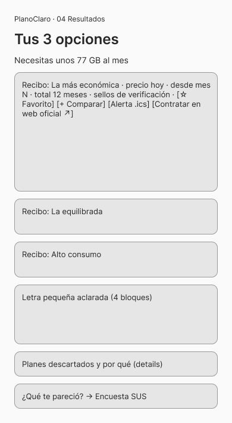

# Wireframes y prototipo en Figma — semana 13

**Archivo de Figma:** https://www.figma.com/design/t6s8touW8Whnms34NH0hrR
«PlanoClaro – Wireframes y prototipo (IHC UCSS)», creado con la integración de Figma.

## Contenido
8 marcos móviles de baja fidelidad: Inicio, Cuestionario A, Cuestionario B, Resultados, Comparador, Cuenta/Medidor, Asistente, Admin y métricas. Tienen enlaces de prototipo (clic → animación inteligente, ease-out, 240 ms) y el flujo empieza en «Inicio».

## Nota sobre la prueba A/B
En los wireframes, la variante B se dibujó como «una pregunta por pantalla». Después del rediseño v3 **las dos variantes muestran una pregunta por pantalla**, y la diferencia es:
- **A:** al elegir una opción, avanza sola (se oculta «Siguiente» en preguntas de una sola respuesta).
- **B:** siempre hay que tocar «Siguiente».
Actualiza los marcos de Figma si el docente lo pide. `[COMPLETAR: fecha de la actualización]`

## Del wireframe al sitio
Las capturas finales del sitio están en `../capturas/` (escritorio 1440 px y móvil 390 px).
